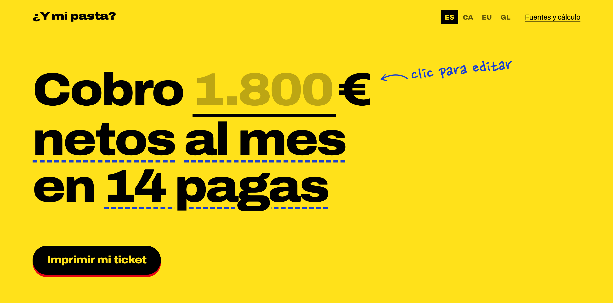
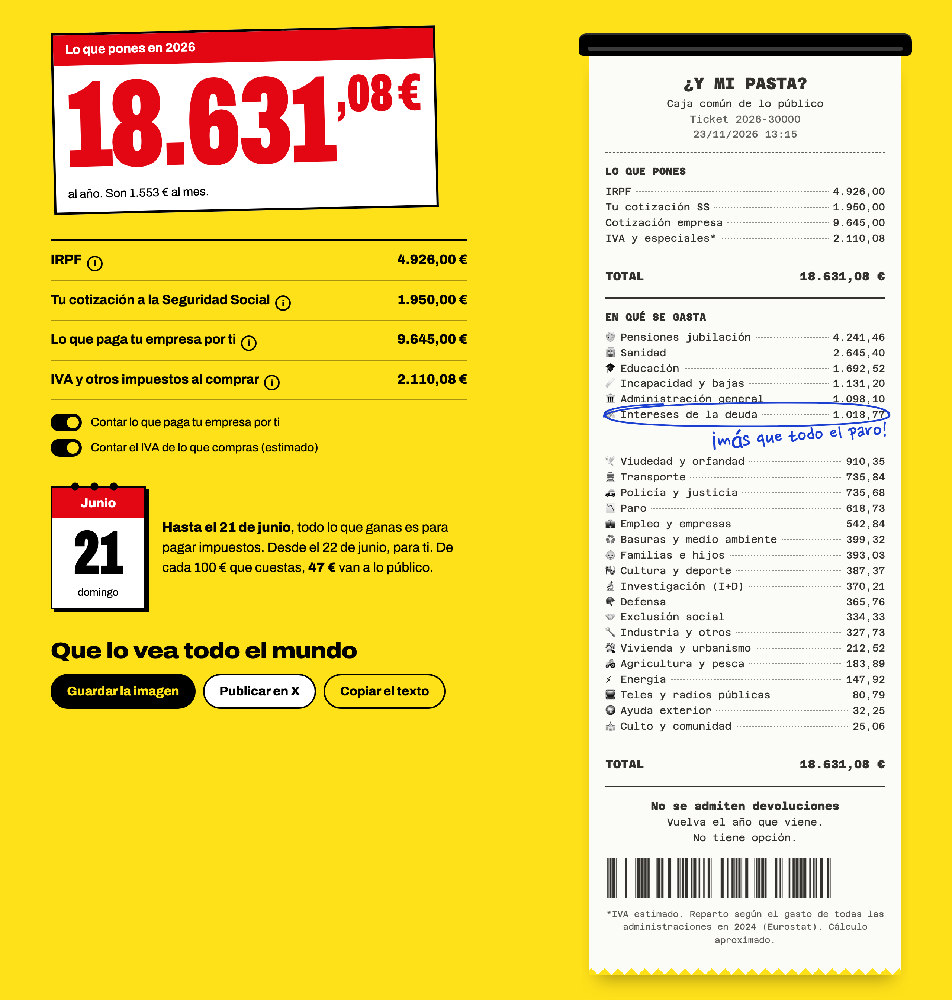
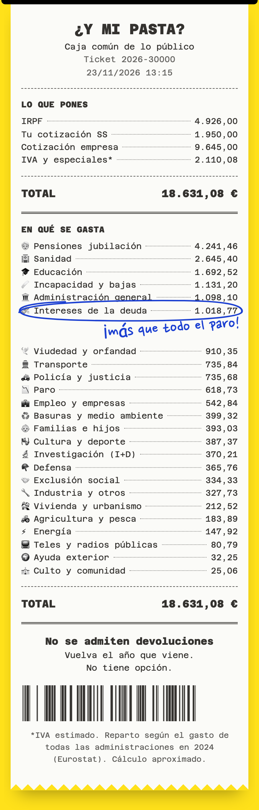
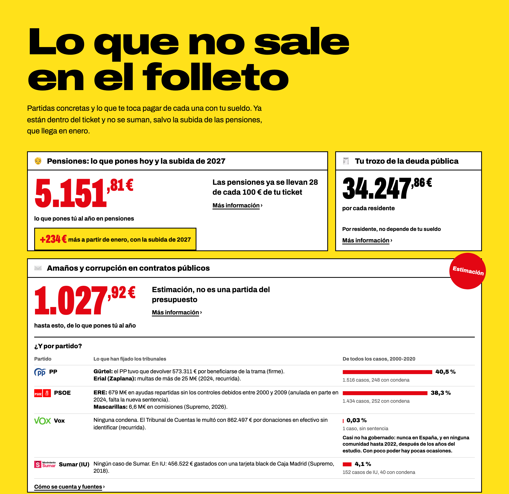
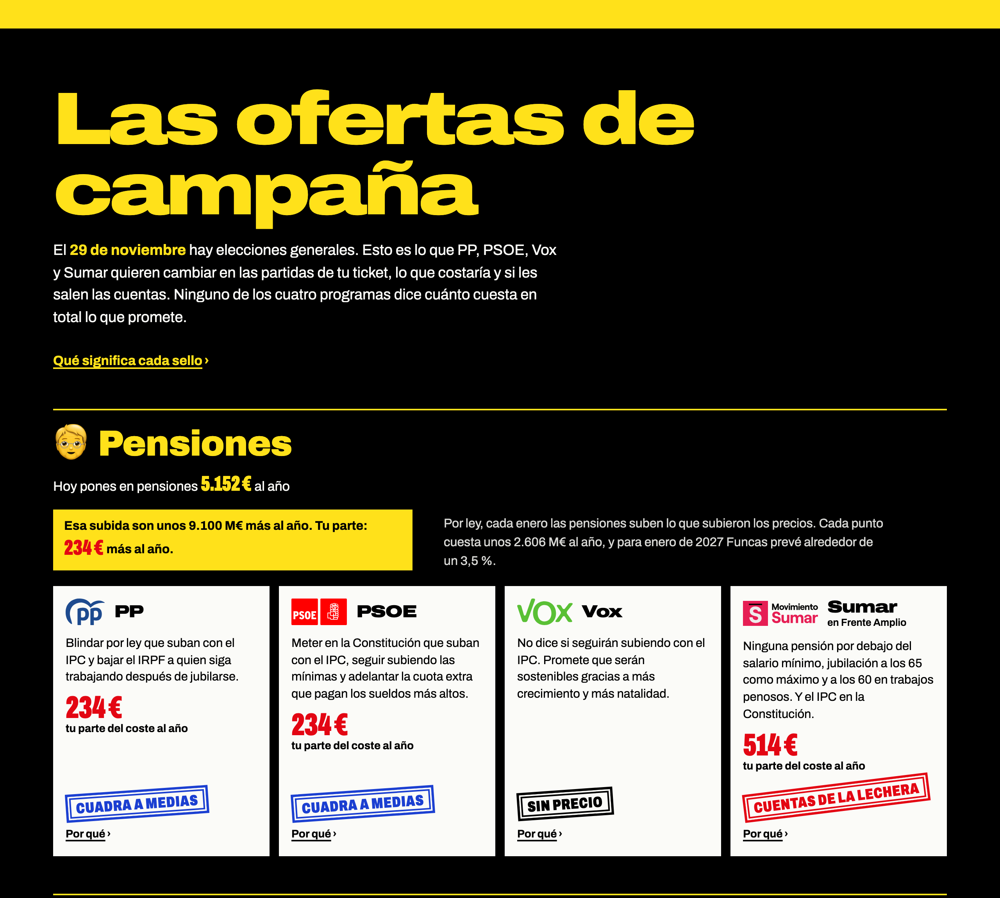

# ¿Y mi pasta?

[](https://github.com/estevecastells/dondevamipasta/actions/workflows/tests.yml)

Pones tu sueldo y te imprime el ticket de lo que pagas en impuestos y en qué se gasta cada euro: pensiones, sanidad, intereses de la deuda, la Casa Real… Y qué proponen los partidos para cada partida y si les salen las cuentas.

**[dondevamipasta.com](https://dondevamipasta.com)**, en castellano, catalán, euskera y gallego.

Es una web estática, sin servidor ni dependencias. Todo se calcula en el navegador: tu sueldo no sale de tu ordenador.



## Cómo se ve

**El ticket**, con 30.000 € brutos al año: lo que pagas de IRPF, cotizaciones e IVA, el día del año en que dejas de trabajar para pagar impuestos y el reparto de cada euro.

<table>
  <tr>
    <td width="64%"></td>
    <td width="36%"></td>
  </tr>
</table>

**Lo que no sale en el folleto**: partidas concretas y lo que te toca pagar de cada una.



**Las ofertas de campaña**: lo que proponen PP, PSOE, Vox y Sumar, lo que costaría y si les salen las cuentas, con el mismo criterio para los cuatro.



## Contribuir

Es de código abierto para que cualquiera pueda revisar las cuentas. Si ves un dato mal, [avísanos](https://github.com/estevecastells/dondevamipasta/issues/new/choose) con la fuente que lo corrige, o propón el cambio tú. Todo está en [CONTRIBUTING.md](CONTRIBUTING.md).

## Arrancarla en local

Solo necesitas Node 22 o posterior y Python 3. No hay nada que instalar.

```bash
npm run dev
```

Y abre http://localhost:5178. Los módulos JS no funcionan abriendo el HTML con doble clic. `tools/serve.py` es como `python3 -m http.server` pero sin caché, para que al recargar se vean los cambios, y genera las páginas de cada idioma.
Para probar también las cabeceras de seguridad de `public/_headers`: `npx wrangler dev`.

## Tests

```bash
npm test
```

Comprueban que las cuentas cuadran (las líneas del ticket suman el gasto total), que cada cifra tiene fuente, que los textos dicen la misma cifra que los datos en los cuatro idiomas, que el IRPF da los valores oficiales y que no falta ninguna traducción. GitHub los pasa en cada *pull request*.

```bash
npm run links
```

Comprueba que los enlaces a las fuentes siguen vivos. GitHub lo pasa cada lunes.

## Publicar

```bash
npx wrangler deploy
```

Genera las páginas de cada idioma y sube la carpeta `public/` al Worker `dondevamipasta` de Cloudflare, enganchado al dominio dondevamipasta.com (ver `wrangler.jsonc`). `www` y `http://` redirigen ahí con una regla de redirección de la zona y «Always Use HTTPS». Solo lo hace quien mantiene la web: fusionar un *pull request* no publica nada.

## Archivos

- `public/data.js`: todas las cifras y sus fuentes (gasto por funciones, partidas del folleto, enlaces). `SITE.url` sale en la imagen para compartir y en el post de X.
- `public/tax.js`: cálculo de IRPF, cotizaciones 2026 e IVA estimado. Con el SMI de 2026 (17.094 €) la cuota antes de la deducción es 590,89 €, el dato oficial de Hacienda. En la versión en euskera (`setRegime('foral')`) usa el IRPF foral de Araba, Bizkaia y Gipuzkoa de 2026 (escala, bonificación del trabajo y minoración de 1.615 €); va por idioma, no se pregunta dónde vive cada uno. Comprobado con la tabla de retenciones vasca de 2026: 30.000 € brutos → 4.495 € (15 %).
- `public/app.js`: la página. Las explicaciones largas se abren en una ventana (`<dialog id="sheet">`), en el móvil y en el escritorio: las de las etiquetas del folleto y sus fuentes, los impuestos, la tabla por partido, el «Por qué» de cada oferta y la leyenda de los sellos. `public/share.js`: la imagen de 1080 × 1350 para X e Instagram. `public/format.js`: números en formato español.
- `public/data.js` → `PROMISES`: «Las ofertas de campaña» (elecciones del 29N). Cada propuesta lleva su coste, su sello (`cuadra`, `medias`, `sinprecio`, `lechera`, con el mismo criterio para todos) y sus fuentes. `public/logos/`: logos de los partidos (dominio público, Wikimedia Commons).
- `public/og.jpg`: la vista previa del enlace (X, WhatsApp, Telegram…), 1200 × 630 y unos 200 KB. Si cambian las cifras, regenérala con `tools/make-og.sh` (usa Chrome sin ventana y `tools/og.html`) y sube el `?v=` de `og:image` en `public/index.html`.
- Iconos: `public/favicon.svg`, y los PNG de móvil con `tools/make-icons.sh` (desde `tools/icons/icon-full.svg`). `public/site.webmanifest` para «Añadir a pantalla de inicio».
- `public/_headers`: cabeceras de seguridad (CSP y demás).
- `tests/`: los tests (`node:test`, sin dependencias). `tools/check-links.mjs`: comprueba los enlaces a las fuentes. `tools/make-screenshots.mjs`: las capturas de este README.

## Idiomas

Castellano, catalán, euskera y gallego, en dondevamipasta.com/es, /ca, /eu y /gl.

- Esas cuatro páginas son `public/es.html`, `ca.html`, `eu.html` y `gl.html` (Cloudflare sirve `ca.html` en `/ca`). Las genera `tools/build-langs.mjs` a partir de `index.html`, con los textos fijos, el título y la vista previa para compartir ya traducidos. `wrangler deploy`, `wrangler dev` y `tools/serve.py` las regeneran solas, así que no están en el repositorio. **No las edites a mano.**
- `public/lang.js` (en el `<head>`) elige el idioma: la dirección (`/ca`…), lo que la persona eligió en el selector de arriba (se guarda en su navegador) o el primer idioma de su navegador que tengamos. Si no hay ninguno, castellano. En la portada (`/`), si toca otro idioma, traduce la página y cambia la dirección a `/ca`, `/eu` o `/gl`. Los enlaces antiguos con `?lang=ca` siguen funcionando.
- Desde `/ca`, `/eu` y `/gl` lo que se comparte enlaza a esa misma página.
- El castellano está en `index.html`, `data.js` e `i18n/es.js` (textos de `app.js` y `share.js`). Las traducciones, en `public/i18n/ca.js`, `eu.js` y `gl.js`, con las mismas claves. `public/i18n.js` las aplica; las fechas («fins a l'1 d'abril», «ekainaren 12ra arte») están en `public/i18n/dates.js`.
- Los textos fijos de `index.html` llevan `data-i18n="clave"` (o `data-i18n-attr="aria-label:clave"`).
- **Si cambias un texto en castellano, cámbialo también en los otros tres.** Para comprobar que no falta nada ni se ha roto una `{variable}` o un enlace:

```bash
npm run check
```

`node tools/i18n.mjs source` saca todos los textos en castellano a `tools/i18n/source-es.json`, por si hay que traducirlos de nuevo.

## Datos

- Reparto: gasto de todas las administraciones por funciones (Eurostat COFOG), 2024, 725.001 M€.
- Partidas del folleto: PGE 2023 prorrogados (Igualdad, Casa Real, Congreso, partidos), Eurostat (intereses, teles públicas, defensa, deuda y déficit 2025), la estimación de la CNMC sobre contratación pública y Exteriores/AECID para la ayuda exterior.
- Impuestos: Orden PJC/297/2026 de cotización y deducción del IRPF para el SMI de 2026.

La lista completa de fuentes, con enlaces, está en «La letra pequeña», al final de la web.

## Pendiente

- Escala autonómica del IRPF por comunidad (ahora usa la supletoria, igual a la estatal).
- IRPF foral de Navarra.

## Licencia

El código es [MIT](LICENSE). Las cifras son datos públicos de las fuentes que se citan. Los logos de `public/logos/` son de dominio público según Wikimedia Commons y son marcas de sus partidos: no entran en la licencia MIT.
